 

<h2 align="center">✦ About Me ✦</h2>

  I'm <b>Md Tahsin Islam</b>, a web developer from <b>Bangladesh</b> 🇧🇩 
  I enjoy turning ideas into clean, fast and thoughtfully designed interfaces. 
  I work mainly with <b>HTML, CSS, JavaScript and TypeScript</b>, 
  and I'm always learning, building and shipping new things.

  
  

Everything above updates automatically from my GitHub activity.

<h2 align="center">✦ Stats & Activity ✦</h2>

  
  

  

  

  

<h2 align="center">✦ Tech Stack ✦</h2>

<!-- Add more icons any time by adding names to the list, e.g. react,nodejs,tailwind,python,figma.
     Icon names: https://github.com/tandpfun/skill-icons#icons-list -->

  

<h2 align="center">✦ Let's Connect ✦</h2>

  
  <!-- Optional: remove the comment markers around a line and put in your own link.
  
  
  -->

  <picture>
    <source media="(prefers-color-scheme: dark)" srcset="https://www.gitskins.com/api/section/heatmap?username=xotahsin&theme=github-dark&mode=dark&style=snake" />
    <source media="(prefers-color-scheme: light)" srcset="https://www.gitskins.com/api/section/heatmap?username=xotahsin&theme=github-dark&mode=dark&style=snake" />
    
  </picture>

© Md Tahsin Islam

