 

<h2 align="center">✦ About Me ✦</h2>

  

  I'm <b>Md Tahsin Islam</b>, a Flutter developer from <b>Bangladesh</b> 🇧🇩 
  I build <b>productivity & tracking apps</b> that help people study better and grow a little every day. 
  I care about calm, thoughtful <b>mobile UI/UX</b>, and I'm currently learning <b>full-stack app architecture</b>.

<h2 align="center">✦ Tech Orbit ✦</h2>

  

<!-- Add more icons any time, e.g. firebase,figma,android,kotlin.
     Icon names: https://github.com/tandpfun/skill-icons#icons-list -->

  

<h2 align="center">✦ Stats & Activity ✦</h2>

  
  

  
  

  

  

Everything above updates automatically from my GitHub activity.

<h2 align="center">✦ Let's Connect ✦</h2>

  
  <!-- Optional: remove the comment markers around a line and put in your own link.
  
  
  -->

<!-- The snake is generated by .github/workflows/snake.yml (free, no watermark).
     It appears after the workflow runs once — see setup steps. -->

  <picture>
    <source media="(prefers-color-scheme: dark)" srcset="https://raw.githubusercontent.com/xotahsin/xotahsin/output/github-snake-dark.svg" />
    <source media="(prefers-color-scheme: light)" srcset="https://raw.githubusercontent.com/xotahsin/xotahsin/output/github-snake.svg" />
    
  </picture>

✦ thanks for stopping by ✦ © Md Tahsin Islam

