 

<a href="#-featured-projects">Projects</a> &nbsp;·&nbsp; <a href="#-github-at-a-glance">Stats</a> &nbsp;·&nbsp; <a href="#-skills">Skills</a> &nbsp;·&nbsp; <a href="#-lets-connect">Connect</a>

<h2 align="center">✦ About Me ✦</h2>

  I'm <b>Md Tahsin Islam</b>, a web developer from <b>Bangladesh</b> 🇧🇩 
  I turn ideas into clean, fast and thoughtfully designed interfaces, 
  with a focus on study systems, productivity tools and self-improvement apps. 
  I work mainly with <b>HTML, CSS, JavaScript and TypeScript</b>, and I'm always learning, building and shipping.

<h2 align="center" id="-featured-projects">✦ Featured Projects ✦</h2>

<table align="center">
  <tr>
    <td></td>
    <td></td>
  </tr>
  <tr>
    <td></td>
    <td></td>
  </tr>
  <tr>
    <td></td>
    <td></td>
  </tr>
</table>

Live: <a href="https://regnar.vercel.app">Regnar</a> &nbsp;·&nbsp; More: <a href="https://github.com/XOTahsin/FrameStudio">FrameStudio</a>, <a href="https://github.com/XOTahsin/Project-Store">Project-Store</a>, <a href="https://github.com/XOTahsin/StudyFlow-V1">StudyFlow-V1</a> &nbsp;·&nbsp; <a href="https://github.com/XOTahsin?tab=repositories">All repositories →</a>

<h2 align="center" id="-github-at-a-glance">✦ GitHub at a Glance ✦</h2>

This card refreshes itself every 12 hours via GitHub Actions.

  <picture>
    <source media="(prefers-color-scheme: dark)" srcset="https://raw.githubusercontent.com/XOTahsin/XOTahsin/output/github-snake-dark.svg" />
    <source media="(prefers-color-scheme: light)" srcset="https://raw.githubusercontent.com/XOTahsin/XOTahsin/output/github-snake.svg" />
    
  </picture>

<h2 align="center" id="-skills">✦ Skills ✦</h2>

  <picture>
    <source media="(prefers-color-scheme: light)" srcset="https://skillicons.dev/icons?i=html,css,js,ts,nextjs,react,supabase,postgres,flutter,git,github,vercel,vscode&theme=light&perline=13" />
    
  </picture>

<h2 align="center" id="-lets-connect">✦ Let's Connect ✦</h2>

  

  
  
  <!-- Add your own:  -->

